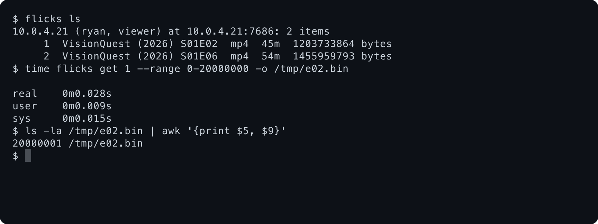

# flicks

A lightweight Plex alternative. Run a Flicks server on a Mac (later Linux and Windows) pointed at your folders; the Flicks app connects to any number of servers and shows them as one library. No account, no paywall, nothing we host: reach a server on your LAN, your tailnet or through a tunnel.

Everything is built here, in Rust, with every UI in Rune. No FFmpeg, no libmpv, no dependencies on other projects' repos. Simple first.

## Where it's at

Built one platform at a time. Live card status is on the agent board; this table is updated as milestones land.

| Milestone | Status |
|---|---|
| 1. macOS server | **Code complete** (8/8 cards). Waiting on the hands-on check: two Macs over LAN and a real tunnel, launchd at real login |
| 2. macOS app | **In progress**: hardware decode, video renderer, audio, subtitles and a Rune fix are being built |
| 3. Linux server | Not started |
| 4. Linux app | Not started |
| 5. Windows | Not started |
| 6. Web | Not started |

### Milestone 1: macOS server

A second machine paired with a Flicks server, listing its library and reading a 20 MB range of an episode:



What's there:

- **`flicks serve`**: one 5.9 MB binary, one HTTPS port (7686), one SQLite database, one key file. Scans folders, watches them for changes, matches titles on TMDB when `FLICKS_TMDB_KEY` is set.
- **Pairing without passwords**: `flicks pair` prints a QR code and a one-time link; the code never travels over the network, and every request after that is signed by the device's own key. Works on the LAN, a tailnet, or through a tunnel (`--addr nas.example.com:443`).
- **Our own media stack**: MKV, MP4 and MPEG-TS readers and H.264, HEVC, AV1, VP9, AAC, AC-3/E-AC-3 and Opus decoders, in Rust.
- **CLI**: `flicks serve`, `folder`, `user`, `pair`, `device`, `status`, `service install` (launchd), and on a client `flicks connect`, `ls`, `get`.

Measured on an M5 Max (details in [`docs/perf.md`](docs/perf.md)):

| | |
|---|---|
| Open a 50 GB MKV | reads 0.4 MB, 0.6 ms |
| First scan of 10,000 files | 0.7 s |
| Rescan of an unchanged library | 23 ms, no files opened |
| First byte of a range read (real 1080p episodes, fresh TLS connection) | 0.6–0.7 ms p95 |
| Start playback (`/play`) | 1.1 ms p95 |

### Try it

```sh
cargo build --release -p flicks-server
target/release/flicks serve &                      # first run creates the server key
target/release/flicks folder add ~/Movies
target/release/flicks pair --user me               # prints a QR code and a flicks:// link
# on another machine with the same binary:
flicks connect 'flicks://pair?...'
flicks ls
```

## Docs

- [`docs/architecture.md`](docs/architecture.md): servers, clients, auth, media stack, apps and crates.
- [`ROADMAP.md`](ROADMAP.md): the work, as cards agents take in parallel.
- [`AGENTS.md`](AGENTS.md): rules and the parallel workflow.
- [`docs/perf.md`](docs/perf.md): every measured number, with methods.
- [`apps/README.md`](apps/README.md): where the apps live.

## Research

- [`research/2026-10-30-fast-stack.md`](research/2026-10-30-fast-stack.md): the fastest stack, layer by layer, with sources. Notes behind it are in [`research/2026-10-30-fast-stack/`](research/2026-10-30-fast-stack/).
